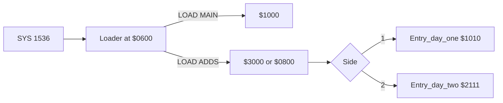
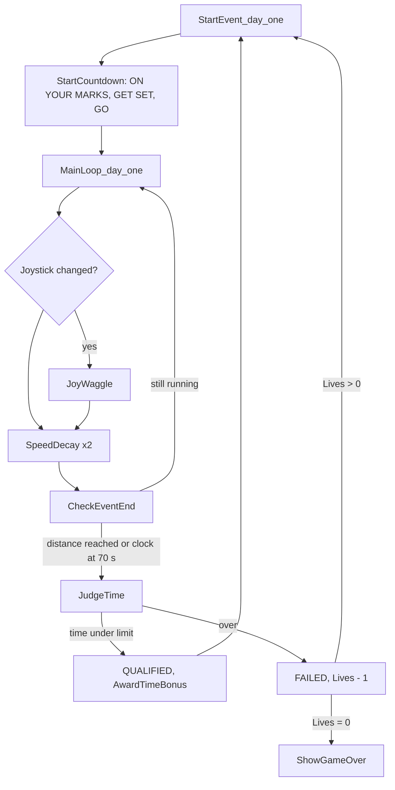
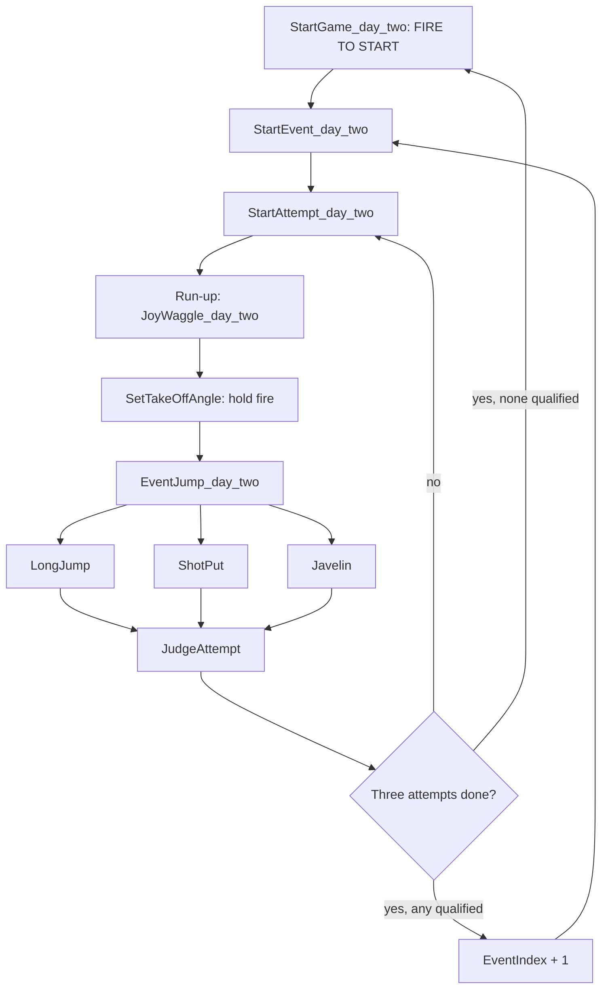

# Codebase Analysis

How the C16 *Daley Thompson's Star Events* works, worked out from the disassembly in `src/` and from runs of the original in VICE. Every name used here is defined in `tools/symbols.py` and listed in the [code reference](docs/CODE_REFERENCE.md); the proof for each role-claiming name is in [the evidence](docs/evidence.md), and the oddities are in [the quirks](docs/quirks.md).

No source code survives, so this is a reconstruction. Where something is read from the code alone (rung 1 on the evidence ladder) it says so; where it was seen running or tested in a controlled run, it says that too.

---

## The Two Parts

The game is two separate programs, one on each side of the tape. Each side has a small loader that loads two files and starts the game; nothing passes from one part to the other.

| Part     | Events                                         | Files on tape          | Entry   |
|:---------|:-----------------------------------------------|:-----------------------|:--------|
| Day One  | 100 m, 110 m hurdles, 400 m, 200 m hurdles     | `MAIN1`, `ADDS1`       | `$1010` |
| Day Two  | Long jump, shot-put, javelin                   | `MAIN`, `ADDS`         | `$2111` |

Day One runs its events in the order 100 m, 110 m hurdles, 400 m, 200 m hurdles (`EventNumber` 1–4), although its text tables list the distances as 100, 400, 110, 200 and index them accordingly. Day Two runs long jump, shot-put, javelin (`EventIndex` 0–2).

Anthony recalls that memory was very tight, so many C64 features were dropped and the game was split in two. The code agrees: each part fills the 16 KB machine to `$3FFF`, with the character set, screen layout and code packed around each other.

---

## Memory Maps

### Day One

| Range           | Contents                                                     |
|:----------------|:-------------------------------------------------------------|
| `$0600`–`$0642` | Tape loader `DALEY1` (only while loading)                     |
| `$0800`–`$0BFF` | Colour RAM (TED attributes)                                  |
| `$0C00`–`$0FFF` | Screen                                                       |
| `$1000`–`$2FFF` | `MAIN1`: code, tables, sound driver and tunes                |
| `$3000`–`$37FF` | `ADDS1`: the packed screen read by `DrawPackedScreen`, from `$3000` |
| `$3800`–`$3FFF` | `ADDS1`: the character set (TED `$FF13` = `$38`, RAM)         |

The character set is live data: `ScrollScenery` rotates the scenery characters' bitmaps at `$39F8` onward, and the hurdles and finish line are drawn pixel by pixel into the 256 bytes at `$3B08` (`ClearObjectChars`, `PlotObjectPixel`).

### Day Two

| Range           | Contents                                                     |
|:----------------|:-------------------------------------------------------------|
| `$0400`–`$07FF` | Character set, copied here from colour RAM by `Entry_day_two` |
| `$0800`–`$0BFF` | Colour RAM; the loader first puts `ADDS` (1 KB) here         |
| `$0C00`–`$0FFF` | Screen                                                       |
| `$1000`–`$3FFF` | `MAIN`: second character set at `$1000`, sound driver at `$1800`, code and data |

Loading a character set into colour RAM and copying it down is how Day Two fits: `ADDS` arrives at `$0800` and `Entry_day_two` copies `$0800`–`$0BDF` to `$0400`–`$07DF` before the screen's colours are written. A raster split switches TED between the sets at `$0400` and `$1000` part-way down the screen.

---

## Start-Up



The tape loader (`TapeLoader_side1`, `TapeLoader_side2`) calls the KERNAL's `SETLFS`, `SETNAM` and `LOAD` twice, telling `LOAD` where to put each file, then jumps to the game. The crunched PRGs in `original/` reach the same entry points through their decruncher's final `JMP`.

Day One starts by unpacking its screen (`DrawPackedScreen`), then `InitGame_day_one` clears the score and sets `Lives` to 3, and `StartEvent_day_one` sets up each event. Day Two clears its zero page, silences the sound, sets up TED (`SetupTed_day_two`), installs its interrupt and goes to the FIRE TO START screen (`StartGame_day_two`).

---

## Interrupts and Raster Splits

Both parts point the KERNAL IRQ vector at `$0314` to their own handler (`IrqHandler_day_one`, `IrqHandler_day_two`) and use only the TED raster interrupt. The handler acknowledges it, calls the next of 13 split routines through a `JSR` whose operand it rewrites from a table (`SplitTable_day_one` at `$15AC`, `SplitTable_day_two` at `$23FB`), and steps a counter through 0–12. Each split sets background colours (and in Day Two, scroll and character set) for the next band and the raster line of the next split, so the 13 splits run once per frame, top to bottom.

| Split (Day One)    | Raster after | Extra work                                       |
|:-------------------|:-------------|:-------------------------------------------------|
| `Split01_day_one`  | `$42`        | `DelayTicks` − 1; `TickRaceClock` while racing   |
| `Split02`–`06`     | `$4A`–`$72`  | Sky bands                                        |
| `Split07_day_one`  | `$9D`        | `SoundStep_day_one` (the sound driver)           |
| `Split08`–`12`     | `$A0`–`$B2`  | Track bands                                      |
| `Split13_day_one`  | `$CB`        | `MoveRace` while racing                          |

So everything time-critical (clock, sound, scrolling) runs at the frame rate, 50 times a second on a PAL C16, while the main loop waits for raster line `$A8` once per pass. Day Two's split 1 also reads the input (`PollInput_day_two`).

---

## Day One: Running Events

### Flow



### Running Speed

The athlete's speed is `RunSpeed`, 0 to `$70`. It rises only through `JoyWaggle`: the main loop reads the joystick each pass and, when the value changes, `JoyWaggle` notes left and right in `WaggleSeen`. Once both have been seen, `RunSpeed` goes up by 5 (by 2 once it reaches `$40`) and `WaggleSeen` is cleared. Holding a direction does nothing; it is the alternation that counts. That matches Anthony's recollection of moving the joystick left and right.

The main loop selects the input by writing `$FD` to both `$FD30` and `$FF08`, so the `$FF08` reading combines a joystick with keyboard row 1 (3, W, A, 4, Z, S, E, SHIFT). A therefore reads as left (bit 2), 4 as right (bit 3), and E and SHIFT as fire (bits 6 and 7, the `$C0` mask used for jumping and for restarting after GAME OVER). Pressing these keys in VICE gave exactly those readings. Anthony's other recollection, alternating two keys, fits this.

The joystick is control port 2. Bit 1 low in the `$FF08` write selects port 2 and bit 2 low would select port 1 (VICE's `ted08_store`), so `$FD` reads port 2 only, with its fire button on bit 7. With a keyboard-driven joystick on each port in VICE, port 2's left and right reached `JoyLast` and port 1's never did. Bit 6 in the `$C0` fire mask is port 1's fire bit, which `$FD` never selects, so in Day One it comes only from the E key. Day Two writes the same `$FD` and masks fire with `$80`, so it also uses port 2.

`SpeedDecay` runs twice each main-loop pass and lowers `RunSpeed` by 1 every 6 calls (every 3 from `$60`), so the top of the range is harder to hold. `DrawSpeedMeter` shows `RunSpeed / 4` as a bar of eight cells at the bottom of the screen.

A controlled run confirmed the role: with `SpeedDecay` patched to `RTS` in VICE's RAM and `RunSpeed` set to `$70` at each start, every event qualified, `Lives` stayed at 3 and the score rose; with no input, every event failed.

### Moving the World

The athlete doesn't move across the screen; the world moves past him. Once a frame, from the last raster split, `MoveRace` turns `RunSpeed` into movement:

1. `RunSpeed / 32` whole steps of `MoveTrackMarks`, plus one more whenever a fraction accumulated in `$2181` carries.
2. Each step moves the two marks on the track (row 23) one sub-character position left, using characters `$3B`–`$3F` as five positions within a cell. Each time a mark crosses a whole cell, `StepAthleteFrame` advances the running animation, so the legs keep pace with the ground.
3. Hurdles and the finish line move with the track marks (`ScrollTrackObjects`).
4. `RunSpeed / 128` steps (plus a fraction) of `ScrollStep`, which rotates the scenery characters one pixel (`ScrollScenery`) and advances the distance (`AdvanceDistance`).

`AdvanceDistance` adds 1 to the four on-screen digits at `$0FD0` every four calls; the distance shown is the game's measure of progress, and `CheckEventEnd` reads it straight from the screen.

### Hurdles and Jumping

Only the hurdle events (2 and 4) draw hurdles: `StartEvent_day_one` sets `HurdleState` to 2 and draws one. Hurdles are drawn into the character bitmap at `$3B08` and moved along the track as the athlete runs. Pressing fire in a hurdle event, when `JumpTimer` is 0, starts a jump: the athlete switches to the jump frames, `JumpTimer` is set to 10, and `SpeedDecay` runs twice more, so every jump costs a little speed.

If a hurdle reaches the athlete's window (`ObjectX` `$26`–`$43`) while he is not jumping, `HurdleState` becomes 1 and the hurdle is drawn knocked over. No other code reads that state for speed or time, so hitting a hurdle changes only the picture. This is listed as a quirk.

### The Finish and the Clock

`CheckEventEnd` ends the event when the distance on screen reaches the event's length (the hundreds digit, plus the tens digit for 110 m) with the athlete still moving, or when the clock's tens digit reaches 7 (70 seconds). Ten metres before the end, `DrawFinishLine` plots the line into the object characters and it scrolls in with the track.

`RaceClock` is five ASCII digits stepped by `TickRaceClock` once a frame while `RaceRunning` is set. Its last digit counts 0–5 and the one before 0–9, so one displayed second is 60 frames: on a PAL C16, 1.2 real seconds. The qualifying times are in those units.

### Qualifying and Scoring

`JudgeTime` copies the clock into the layout of `QualifyTimes` and compares them digit by digit:

| Event           | Qualifying time | `QualifyIndex` |
|:----------------|:----------------|:---------------|
| 100 m           | 013:00          | 0              |
| 110 m hurdles   | 015:00          | 12             |
| 400 m           | 060:00          | 6              |
| 200 m hurdles   | 038:00          | 18             |

Under the time, it prints QUALIFIED, plays `PlayQualifiedSound` and calls `AwardTimeBonus`, which adds 6 points to the score 255 − (sum of three of the time's ASCII digits) times. Faster times give a smaller digit sum and so more points; every score rise seen in VICE was a multiple of 6. Over the time, it prints FAILED, plays `PlayFailedSound` and takes one of `Lives`. At 0, `ShowGameOver` prints GAME OVER, plays a tune and waits for fire.

`Score` is six decimal digits (0–9 per byte, not BCD) shown at the top of the screen; `AddScore` adds `ScorePending` into it with a carry per digit. After the 200 m hurdles, `EventNumber` goes back to 1 and the four events run again with the score kept.

The RECORDS box shows three fixed times per event from `RecordTimes`; the game never writes the player's time into it.

---

## Day Two: Field Events

### Flow



### Input

Day Two takes the joystick or the keyboard. On the start screen, `SelectInputMode` sets `InputMode` from two keys and prints KEY or JOY at the bottom left; the keys are J (joystick) and K (keys). `ReadInput`, called from raster split 1, sets `InputBits` (bit 7 fire, bit 3 right, bit 2 left) from the joystick or, with keys, from three keys that decode to Q (left), Y (right) and SPACE (fire). All five keys were confirmed by pressing them in VICE: J and K switch the mode and its text, and Q, Y and SPACE reach `ReadKeys` as left, right and fire.

### Run-Up and Take-Off

The run-up uses the same waggle scheme as Day One. `JoyWaggle_day_two` raises `RunSpeed_day_two` (0–`$1F`) by 5, or by 2 from `$0C`, each time it has seen both left and right. `SpeedDecay_day_two` lowers it every 2 calls with the joystick and every 3 with keys, so the keyboard is slightly easier to keep fast.

At the line, holding fire runs `SetTakeOffAngle`: in decimal mode it counts `AngleBcd` up from 20, shown as the two digits before `°` on the score line, until fire is released or it reaches 83. `ClassifyAngle` sorts the angle into three bands (below 35, 35–54, 55 and over), `TakeOffSpeed` keeps the run-up speed, and the self-modified `JMP` at `EventJump_day_two` goes to the event's handler. Running on past the take-off point (`AthleteX`, which counts down from `$9B`, falling below `$50`) without taking off is a foul.

### How Far: the Distance Counter

The distance isn't calculated from a formula; it's counted while the world scrolls. Once a frame, `ScrollRunway` scrolls the runway band by `RunwayScrollStep` − 1 pixels. Each time a whole character passes, `RunwayCellStep` calls `AddFlightDistance`, which waits out `TakeOffDelay` cells and then adds to `AttemptDistance`:

| Event      | Tenths per cell | Random hundredths per cell |
|:-----------|:----------------|:---------------------------|
| Long jump  | 1               | 0–1                        |
| Shot-put   | 2               | 0–3                        |
| Javelin    | 7               | 0–3                        |

The random part comes from TED timer 1 (`$FF00`), so two identical attempts can differ by a few hundredths. The table is `DistanceRates`.

The counting runs from take-off to landing. During the run-up `RunUpScrolling` is set and `ScrollRunway` sends no cells to `RunwayCellStep`; take-off clears it and zeroes `RunwayCellCount`, and the handler stops the runway at the landing. Every 14th cell (`RunwayCellCount` reaching `$0E`) puts a marker at the right edge of the runway and adds nothing.

So the distance is (cells scrolled during the flight) × (the event's rate). The cells scrolled are the flight's length in steps times the scroll rate, and the inputs act on these factors:

- **Scroll rate.** All three handlers build `FlightStep` from `TakeOffSpeed`, then copy it to `RunwayScrollStep`. The shifts take bits 4, 2 and 0 of the speed (0–`$1F`) and add 2, giving 2–9, so the rate does not grow steadily with speed: `$1D` and `$1F` give 9, `$1C` and `$1E` give 8, `$18` and `$10` give 6. Wherever the speed counts, `$1D` goes further than `$1E`.
- **Flight length.** Each handler moves its figure a fixed amount a step, with a fixed `DelayXY` between steps, from the start height up to `PeakRow` and back down. `PeakRow` is higher on screen for a steeper `Angle`.
- **Take-off position.** `TakeOffDelay` = `AthleteX` / 4 − `$13` cells pass before counting starts.

#### Long Jump

`LongJump` moves the athlete's row (`NextAthleteRow`) up from row 15 to `PeakRow` = ((`Angle` − 20) XOR `$3F`) / 8 + 7, one row a step with every seventh step skipped (`Every7Rising`). It then hangs for `HangTime` = (`TakeOffSpeed` AND `$1C`) / 2 + 2 steps and falls two rows a step (`Every7Falling`) to row 15. While `InFlight`, each scrolled cell also moves the athlete along the runway (`AdvanceAthlete`); once `AthleteX` is below `$10`, the runway band turns from red track to yellow sand (`RunwayBandColour`). The hang doesn't end until that happens, so the jumper can't land before reaching the pit. At 60° and over (`PeakRow` below 10) the handler halves `TakeOffSpeed`, which shortens the hang, and fixes the scroll at 5.

#### Shot-Put

The shot starts at pixel row `$70` (`ShotY`). `FollowThrough` first walks the athlete back to column 0, lifting the shot by `AngleClass` each step, while the runway already scrolls. `ShotPutLoop` then raises `ShotY` by `AngleClass` (1 below 35°, 2 for 35–54°, 3 from 55°) to `PeakRow` = ((`Angle` − 20) XOR `$3F`) + `$33`, and lowers it again to `$9B`. Only at 35–54° does the scroll use `FlightStep`. Outside that band it is (`FlightStep` AND 3) + 1, so speeds `$1C`–`$1F` give a scroll of 1 or 2 and a slow run-up throws further.

#### Javelin

The javelin starts at pixel row `$68` (`JavelinY`) and rises one pixel a step during `FollowThrough`. `JavelinLoop` raises it by `AngleClass` to `PeakRow`, holds it level for `JavelinHang` = (`TakeOffSpeed` AND `$1C`) / 2 + 6 steps, and lowers it by `AngleClass` to `$96`. On the way it turns nose-down from `$8C` (`JavelinPhase` 3), which picks its characters (`JavelinChars`). From 67° (`PeakRow` below `$44`) the scroll is fixed at 4. Below 35° the javelin falls one pixel a step instead of two, so the shallowest angles fly longest.

#### Measured Distances

`tools/flight_probe.py` forces take-offs in VICE RAM. It sets `RunSpeed_day_two`, puts `AthleteX` at `$50` (the line, `TakeOffDelay` 1) and the athlete at column `$0E` as a full run-up leaves him, then sets the angle. The flight code then runs unchanged. Distances in metres; the last digit varies by a few hundredths between runs:

| Angle | LJ `$10` | LJ `$1D` | LJ `$1E` | SP `$10` | SP `$1D` | SP `$1E` | JV `$10` | JV `$1D` | JV `$1E` |
|:------|:---------|:---------|:---------|:---------|:---------|:---------|:---------|:---------|:---------|
| 25°   | 3.98     | 8.73     | 7.62     | 4.96     | 2.53     | 1.08     | 69.82    | 122.13   | 106.68   |
| 35°   | 4.19     | 9.54     | 8.21     | 9.64     | 15.95    | 13.81    | 47.14    | 84.43    | 73.47    |
| 45°   | 4.94     | 10.53    | 9.38     | 9.46     | 15.76    | 13.75    | 48.70    | 87.23    | 75.87    |
| 55°   | 5.25     | 11.09    | 9.64     | 3.18     | 1.50     | 0.67     | 45.74    | 82.58    | 72.46    |
| 59°   | 5.09     | 11.03    | 9.61     | 3.15     | 1.54     | 0.68     | 48.53    | 87.31    | 75.75    |
| 60°   | 4.62     | 4.58     | 4.54     | 3.20     | 1.54     | 0.65     | 48.60    | 87.02    | 75.74    |
| 66°   | 4.64     | 4.50     | 4.58     | 3.19     | 1.51     | 0.63     | 51.33    | 92.29    | 79.90    |
| 67°   | 4.62     | 4.59     | 4.58     | 3.46     | 1.50     | 0.88     | 30.14    | 32.87    | 33.59    |
| 75°   | 4.63     | 4.61     | 4.56     | 3.87     | 1.66     | 0.86     | 33.61    | 36.46    | 35.66    |

(LJ long jump, SP shot-put, JV javelin; `$10`, `$1D` and `$1E` are the speed at take-off.) Speed `$1F` measures within a few tenths of `$1D` throughout. The best results are about 11.1 m in the long jump at 55–59° (below the 11.87 m world record), 16.0 m in the shot-put at 35–45° (record 17.60 m), and 122 m in the javelin under 35°, past the 101.30 m world record.

Taking off early costs distance in every event, as `TakeOffDelay` predicts. At speed `$1F` and 45°, moving the take-off from `AthleteX` `$50` (the line) to `$9B` (where the board first appears) cuts the long jump from 10.64 m to 9.00 m, the shot-put from 15.66 m to 11.58 m and the javelin from 87.38 m to 73.58 m (`tools/flight_probe.py --position`).

These are rung 3 for the flight code and the counter. The run-up itself was not played: the probe sets the speed and the athlete's column directly.

### Attempts and Judging

Each event allows three attempts (`AttemptNumber` 0–2). `JudgeAttempt` compares the attempt's distance (`AttemptDistance`, five ASCII digits) with the event's entry in `QualifyLengthTable`:

| Event      | World record | Qualifying length |
|:-----------|:-------------|:------------------|
| Long jump  | 011.87 m     | 006.80 m          |
| Shot-put   | 017.60 m     | 013.90 m          |
| Javelin    | 101.30 m     | 065.70 m          |

A longer distance sets `AttemptResult` to 1 (qualified), otherwise `$FF`. A distance beating `BestTable` is copied in as the new best, and a qualified one is also compared with `WorldRecordTable`. The three results are kept in `AttemptResults`, and `ShowAttemptMarks` colours the three marks by the FOUL label. `AddDistanceToScore` adds the metres and tenths to the score and keeps a `HighScore`.

After three attempts, any qualified one moves to the next event; after the javelin, `EventIndex` goes back to the long jump. If none qualified, the game returns to the FIRE TO START screen. A run in VICE with the fire wait patched out showed the cycle: three failed attempts, then back to the start.

---

## Graphics

Both parts are character-mode screens using multicolour characters from RAM. Day One's athlete is two 6×3-character halves drawn from `AthleteFrames` (`DrawAthlete`), with frames 36 bytes apart. Day Two's athlete is a 6×6 block of characters `$C6` down (`DrawAthlete_day_two`).

Motion is done with characters rather than hardware sprites, which the C16 doesn't have:

- **Scenery** scrolls by rotating the bitmaps of seven characters one pixel at a time (`RotateCharsLeft`).
- **Track marks** move through five pre-drawn characters for the sub-cell positions.
- **Hurdles and the finish line** are drawn pixel by pixel into a 256-byte block of the character set.
- **Day Two's advert boards** scroll a whole character at a time (`ScrollAdvertBoards`), and its big title letters are glyph numbers (`TitleGlyphs`).

The advert boards (Barclays, Lee Cooper, Pepsi, Ocean, Boots, WH Smith) were copied from the C64 version, as Anthony recalls.

---

## Sound

Both parts carry the same sound driver at different addresses (part 1 around `$22E0`–`$2BFF`, part 2 at `$1800`), entered through a small jump table (`SoundVectors_day_one`, `SoundVectors_day_two`). `SoundStep_day_one` runs once a frame from raster split 7. Tunes start through `PlayTunePair_day_one` / `PlayTunePair_day_two`, which take two inline words after the `JSR` (one per voice) and return past them. Short effects start through `StartSoundEffect` with a 23-byte record.

The footstep effect gets its pitch from successive bytes of the BASIC ROM (`PlayFootstep` reads `$A000` onward, `PlayFootstep_day_two` `$A063` onward), a cheap source of noise. Sound has not yet been compared with real hardware.

---

## Routine Contracts

The key routines in the format of the skill's `analysis.md`. Each one states only what the evidence establishes.

### `JoyWaggle` (Day One, `$19BE`)

```text
Purpose and scope:     turn joystick alternation into speed
Entry / calling:       from MainLoop_day_one when the $FF08 value changes; A = new value
Inputs:                A (active low: bit 2 left, bit 3 right), WaggleSeen, RunSpeed
Outputs and clobbers:  WaggleSeen, RunSpeed (via SpeedUp); A, X, Y
Side effects:          DrawSpeedMeter via SpeedUp
Algorithm:             both bits low (or both high) ignored; left sets bit 1, right bit 0;
                       at 3: five SpeedUp calls below $40, two from $40; WaggleSeen = 0
Evidence:              rung 3 for RunSpeed (controlled VICE run) and for the bits and port
                       (keys and a keyset joystick traced in VICE)
Unresolved:            none
```

### `MoveRace` (Day One, `$2111`)

```text
Purpose and scope:     move the world past the athlete once a frame
Entry / calling:       Split13_day_one, while RaceRunning
Inputs:                RunSpeed; fraction accumulators $2181 and $2183
Outputs and clobbers:  track marks, objects, scenery, distance digits; A, X, Y
Algorithm:             RunSpeed/32 MoveTrackMarks (+1 on fraction carry) with ScrollTrackObjects;
                       RunSpeed/128 ScrollStep (+fraction)
Evidence:              rung 1; distance rising with speed seen in the controlled runs
Unresolved:            exact fraction rates per step
```

### `JudgeTime` (Day One, `$21DF`)

```text
Purpose and scope:     decide QUALIFIED or FAILED
Entry / calling:       from CheckEventEnd at the finish or the 70 s limit
Inputs:                RaceClock, QualifyIndex, QualifyTimes
Outputs and clobbers:  score (AwardTimeBonus) or Lives - 1; message at $0EB6; A, X, Y
Algorithm:             six-character compare, most significant first; below: QUALIFIED;
                       above: FAILED; equal: returns with neither
Evidence:              rung 3: both outcomes seen in VICE
Unresolved:            the equal-time case is not observed
```

### `JudgeAttempt` (Day Two, `$3295`)

```text
Purpose and scope:     judge a field-event attempt
Inputs:                EventIndex, AttemptDistance, QualifyLengthTable, BestTable, WorldRecordTable
Outputs and clobbers:  AttemptResult and $7D (1 or $FF), BestTable entry; A, X, Y
Algorithm:             five-digit subtraction qualifying - distance; borrow means longer (qualified);
                       same against best (copy if longer); if qualified, against the world record
Evidence:              rung 1; the attempt cycle seen in VICE (failed attempts only)
Unresolved:            what follows beating the world record
```

---

## Coverage

VICE's execution map (`memmapshow`) was recorded over three runs: Day One with no input, Day One with the speed held (all four events qualified), and Day Two's attempt cycle. Every executed instruction lies on an instruction start of the traced disassembly, so no code is missing from the trace. The routines that never ran, and that nothing references, are listed as open items in [the quirks](docs/quirks.md): an uncalled screen-digit counter and tune call in Day One, and a timer-reading routine and a hex printer in Day Two.

The runs didn't exercise jumps, throws or a qualified attempt in Day Two, so "never executed" there isn't proof of dead code. For those parts, the static search (no reference anywhere) is the main evidence.
