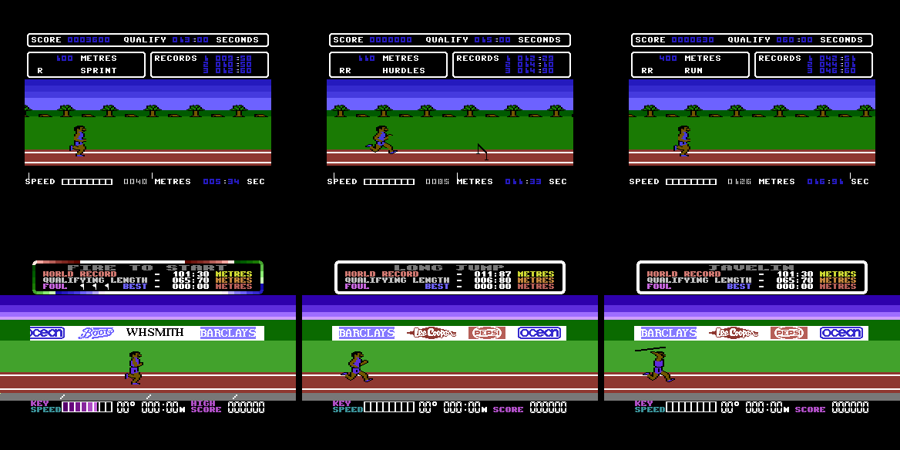

# Daley Thompson's Star Events C16


I wrote *Daley Thompson's Star Events* for the Commodore 16 with my business partner Jason Perkins in 1985, for Ocean Software. It is a conversion of Ocean's C64 decathlon game, kept as close to it as a 16 KB machine allowed. No source survives, so this project rebuilds the game from the surviving binaries: a documented disassembly that reassembles byte for byte, with the evidence for every name and a measured account of how the game works.

Everything is collected in the [complete offline HTML handbook](docs/DALEY_THOMPSON.html): history, how to play, how the code works, every graphic, the tunes as playable clips, and how each claim was checked. It is generated from the Markdown files here; [maintaining the HTML](docs/HTML_DOCUMENTATION.md) has the details.



---

## The Game

The game comes in two parts, one on each side of the cassette, because the C16's memory couldn't hold all seven events at once.

**Day One** is four races in a fixed order: 100 m, 110 m hurdles, 400 m and 200 m hurdles. You run by moving the joystick left and right in turn, and the speed meter drains all the time, faster near the top; fire jumps the hurdles. Each race has a qualifying time; beat it to score, miss it and lose one of your three attempts. After the 200 m hurdles the races start again with your score kept.

**Day Two** is the long jump, shot-put and javelin, with three attempts at each. You build speed the same way, then hold fire at the line to set the angle and release to jump or throw. Qualify with any of the three attempts to go on to the next event. Day Two can also be played on the keyboard.

Both parts run in multicolour character mode with no sprites: the athlete, the hurdles and the scrolling scenery are all characters redrawn as they move, and Day Two scrolls the advertising boards of the C64 version behind the track. The title and GAME OVER tune is *Chariots of Fire*. [Playing the game](docs/PLAYING.md) has the controls, the qualifying times and lengths and what makes a long throw, all worked out from the code.

---

## What the Decomposition Found

A few highlights; each links to the full account.

- **The tapes and the PRGs hold the same game.** The 1985 tape's files equal the unpacked images byte for byte, and the crunched PRGs were made from them between 2008 and 2017 with Exomizer 2.0 ([artifacts](docs/ARTIFACTS.md)).
- **The race clock runs slow on a PAL C16.** A displayed second is 60 frames, 1.2 real seconds; on an NTSC machine it is exactly one ([quirks](docs/quirks.md)).
- **The javelin can beat the world record.** A full-speed throw below 35° goes about 122 m against the game's own 101.30 m record ([how far](CODEBASE_ANALYSIS.md#how-far-the-distance-counter)).
- **Knocking a hurdle over costs nothing.** It only changes the hurdle's picture ([hurdles and jumping](CODEBASE_ANALYSIS.md#hurdles-and-jumping)).
- **Day One answers to the keyboard.** It has no key option, but the way it reads the joystick also reads A, 4, E and SHIFT ([running speed](CODEBASE_ANALYSIS.md#running-speed)).
- **The tunes.** All three tunes are shared by both parts, and Day One still holds the qualified tune it never plays ([the tunes](CODEBASE_ANALYSIS.md#the-tunes)).

---

## Verified Build

All **40,724 bytes** of the six blocks rebuild exactly from `src/`: both crunched PRGs with their decrunchers, both tape loaders and both unpacked parts. `make verify` checks this on every change, together with the originals' hashes, the unpacking and the tape files. No byte is copied from an original into the source; the bytes come from the disassembly, and every routine, variable and table has a name with its evidence recorded.

The rebuilds start the same way as the originals in VICE (compared side by side in [source and validation](docs/SOURCE_AND_VALIDATION.md#the-gate-make-verify)), and each tape side loads and runs through its own loader. Measurements come from controlled runs in VICE, such as 189 forced take-offs for the Day Two distances. Manual play, listening on real hardware and running on a real C16 or Plus/4 remain untested; [the worklist](docs/WORKLIST.md) lists what still needs a person. [Source and validation](docs/SOURCE_AND_VALIDATION.md) explains how the work was done and how it is checked.

---

## Build and Run

I use Python 3.10 or later, the cc65 tools (`da65`, `ca65`, `ld65`), VICE (`xplus4`) and, for the handbook, Node.js 20 or later:

```sh
brew install cc65 vice node
make verify
make run-original
```

`make verify` checks the originals and rebuilds every block. `make run-original` starts the original Day One in VICE as a 16 KB PAL C16 (`PART=two` for Day Two); `make run` and `make run-unpacked` start the rebuilds, and `python3 tools/run_tape.py 1` loads a side from tape the way the 1985 instructions say. `make docs` regenerates the code reference and the handbook. [Build and run](docs/BUILD_AND_RUN.md) lists every target and script.

---

## What's in the Repository

| Path                     | What it holds                                 |
|:-------------------------|:----------------------------------------------|
| `original/`              | The six original files, read-only, hashed     |
| `Original Assets/`       | Cassette, inlay, advert and loading slip      |
| `src/`                   | The disassembly, generated, never hand-edited |
| `tools/symbols.py`       | Every name, range and comment: the master     |
| `tools/`                 | Disassembler, checks, probes and renderers    |
| `docs/`                  | The handbook chapters and the HTML handbook   |
| `docs/images/`           | Screenshots and graphics drawn from the game  |
| `docs/sounds/`           | The tunes and effects as audio clips          |
| `scripts/`               | Handbook generator, shared with my C16 repos  |
| `CODEBASE_ANALYSIS.md`   | How both parts work                           |
| `Makefile`               | `verify`, `disasm`, `run`, `docs` and more    |
| `build/`                 | Rebuilt binaries and screenshots (ignored)    |

The six originals are the two sides of the 1985 cassette as tape images, the two crunched PRGs and the two unpacked images dumped from VICE for this project; [the artifacts](docs/ARTIFACTS.md) describe each one.

---

## Documentation

| Chapter                                                | What it covers                                     |
|:-------------------------------------------------------|:---------------------------------------------------|
| [History and credits](docs/HISTORY_AND_CREDITS.md)     | Who wrote it, the packaging, recollections         |
| [Playing the game](docs/PLAYING.md)                    | Loading, controls, every event, scoring            |
| [Artifacts](docs/ARTIFACTS.md)                         | The tapes, the loader and the crunched PRGs        |
| [Codebase analysis](CODEBASE_ANALYSIS.md)              | How both parts work, with the sounds               |
| [Graphics](docs/GRAPHICS.md)                           | Screens, character sets, the athlete, the boards   |
| [Source and validation](docs/SOURCE_AND_VALIDATION.md) | How the work was done and how it is checked        |
| [Build and run](docs/BUILD_AND_RUN.md)                 | Make targets, scripts and tools                    |
| [Evidence](docs/evidence.md)                           | The proof behind each name                         |
| [Quirks](docs/quirks.md)                               | What the original does oddly, kept in the build    |
| [Worklist](docs/WORKLIST.md)                           | What is checked and what still needs a person      |
| [Changelog](CHANGELOG.md)                              | Every change to the project                        |
| [Code reference](docs/CODE_REFERENCE.md)               | Every name, generated from `tools/symbols.py`      |

---

## History and Related Repositories

Ocean's owner, D.C. Ward, commissioned the C16 version; Jason and I wrote it on a C64 by watching the C64 game, with no material from Ocean. [History and credits](docs/HISTORY_AND_CREDITS.md) records what I remember, the cassette, the inlay and Ocean's advert, and what the code adds.

My other C16 restorations use the same documentation format and handbook generator. Unlike this one, they rebuild from my recovered source code:

- [Dork's Dilemma C16](https://github.com/anthonyjclarke/Dorks_Dilemma_C16), which also tells the story of my development setup and the source recovery.
- [Tycoon Tex C16](https://github.com/anthonyjclarke/Tycoon_Tex_C16).
- [Xargon Wars C16](https://github.com/anthonyjclarke/Xargon_Wars_C16) and its sequel [Xargon's Revenge C16](https://github.com/anthonyjclarke/Xargons_Revenge_C16), continued in [Xargon's Revenge C16 v2](https://github.com/anthonyjclarke/Xargons_Revenge_C16_v2).

The game and its packaging are © 1985 Ocean Software, as the inlay states. The original files are kept here for preservation and study; changes to this project are recorded in the [changelog](CHANGELOG.md).
