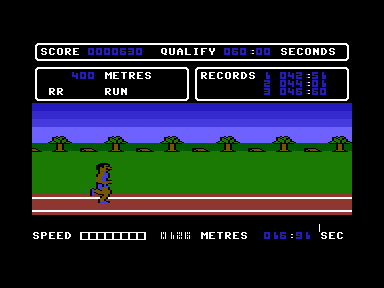
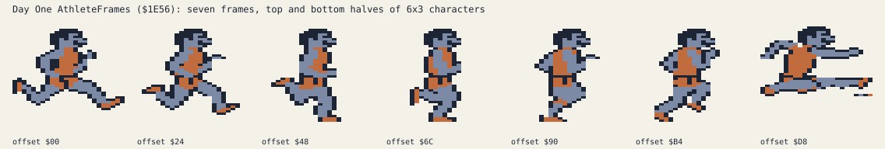
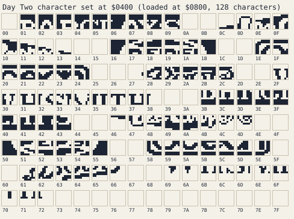
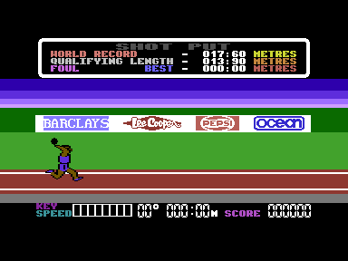

# Graphics

The C16 has no hardware sprites, so everything that moves in *Star Events* is made of characters. This chapter shows the character sets and the athlete as they sit in memory, and explains the techniques used to animate them. The pictures are drawn straight from the original images by `tools/render_graphics.py`; the screenshots come from VICE by `tools/doc_shots.py`.

---

## Screen Layout

Both parts use TED's 40×25 character screen at `$0C00` with colour RAM at `$0800`, in multicolour character mode (`$FF07` bit 4). A multicolour cell shows four colours in pixel pairs: the three background registers `$FF15`–`$FF17` and the cell's own colour. Thirteen raster splits a frame rewrite the background registers, so each horizontal band of the screen (sky, scenery, track, panels) gets its own palette from the same characters.

Day One's screen is unpacked at the start of each event from a packed description at `$3000` (`DrawPackedScreen`). The codes `$FB`–`$FF` mean a run of one character, a new address, the next row, a new colour, and the end; every other byte is a character.

Day Two draws its screen in pieces (`DrawEventScreen`, `DrawPieceList`) and writes the event's title in a large font made of characters, from glyph numbers (`TitleGlyphs`).

---

## Day One's Character Set

The set lives at `$3800`, the top of the `ADDS1` file, and is drawn here as 1-bit pixels, so multicolour characters look striped. Visible in it:

- **Letters and digits** at `$01`–`$1A` and `$30`–`$39`; `$12`, the R, doubles as the lives symbol.
- **The speed meter's fill steps** at `$21`–`$25`.
- **The track mark's five sub-cell positions** at `$3B`–`$3F`.
- **The scenery strip** at `$3F`–`$4C`.
- **The athlete** from `$8C` upward.

Several characters are rewritten while the game runs. The scenery characters are rotated a pixel at a time by `RotateCharsLeft`, and the 256 bytes at `$3B08` are cleared and redrawn every frame with the hurdle or the finish line.

---

## Day One's Athlete

The athlete is two blocks of 6×3 characters, top and bottom, drawn at `$0E5E` and `$0ED6` by `DrawAthlete`. `AthleteFrames` holds seven frames of 36 bytes: character codes, with spaces left transparent. Frames are selected by offset (`AthleteTopFrame`, `AthleteBottomFrame`), and `StepAthleteFrame` advances them whenever a track mark crosses a cell, so the stride matches the ground's speed. Fire in a hurdle event switches to the jump frames at offsets `$B4` and `$D8`.

The colours in this picture are neutral stand-ins for the four multicolour values; on screen they come from the raster split that covers the athlete's rows.

---

## Moving Things Without Sprites

| Effect            | How it's done                                                      | Routine             |
|:------------------|:-------------------------------------------------------------------|:--------------------|
| Scenery scroll    | Rotate seven characters' bitmaps one pixel left as one strip       | `RotateCharsLeft`   |
| Track marks       | Step through five pre-drawn characters, then move one cell         | `MoveTrackMarks`    |
| Hurdles           | Two bitmap sets copied into a 256-byte block of the character set  | `DrawHurdleA/B`     |
| Finish line       | Plotted pixel by pixel into the same block                         | `DrawFinishLine`    |
| Athlete           | Character frames swapped in place                                  | `DrawAthlete`       |
| Day Two's boards  | Screen and colour rows shifted a whole character                   | `ScrollAdvertBoards` |

The world moves; the athlete stays put. `MoveRace` turns `RunSpeed` into whole and fractional steps for each of these once a frame, so faster running scrolls everything faster ([codebase analysis](../CODEBASE_ANALYSIS.md#moving-the-world)).

---

## Day Two's Character Sets

Day Two has two sets. The first is loaded into colour RAM at `$0800` by the tape loader and copied down to `$0400` by `Entry_day_two`. The second is at `$1000`, inside `MAIN`. A raster split switches TED between them part-way down the screen.

Day Two's athlete is a 6×6 block of characters counting down from `$C6` (`DrawAthlete_day_two`). The shot and the javelin are drawn as separate small objects (`DrawShotBall`, `DrawJavelinShaft`).

