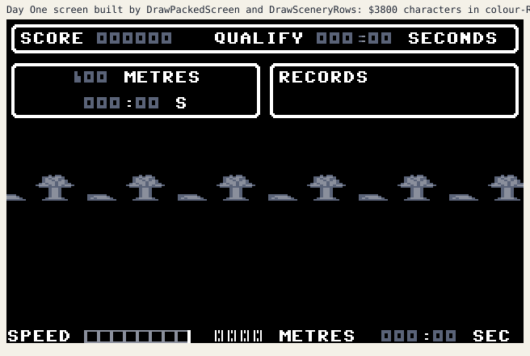
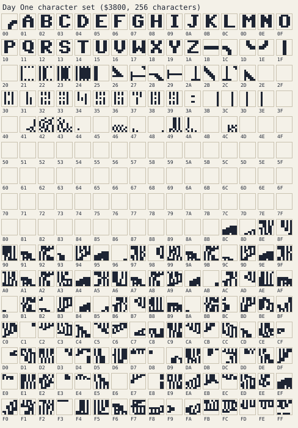
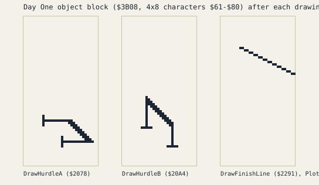
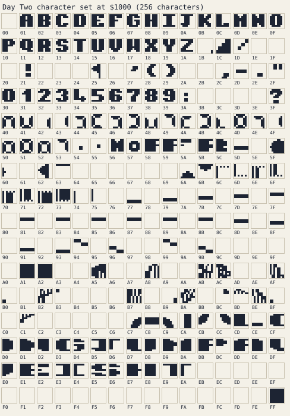
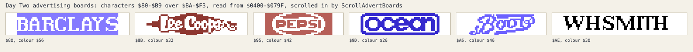
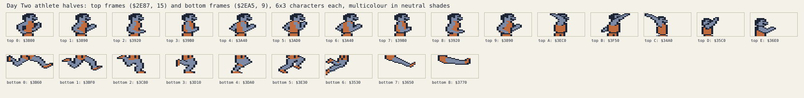
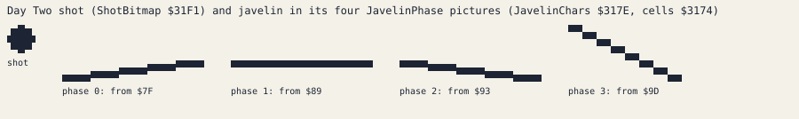
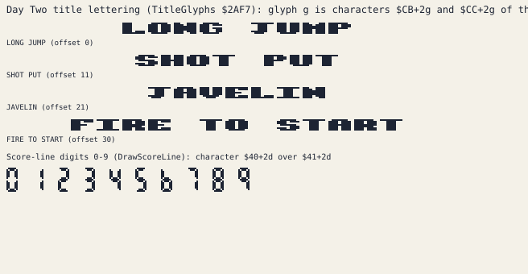
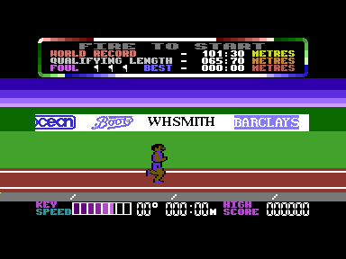
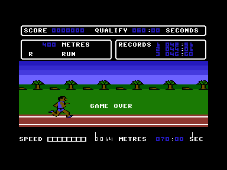

# Graphics

The C16 has no hardware sprites, so everything that moves in *Star Events* is made of characters. This chapter shows the character sets and the athlete as they sit in memory, and explains the techniques used to animate them. The pictures are drawn straight from the original images by `tools/render_graphics.py`; the screenshots come from VICE by `tools/doc_shots.py`. A screenshot of every event is in [playing the game](PLAYING.md).

---

## Screen Layout

Both parts use TED's 40×25 character screen at `$0C00` with colour RAM at `$0800`, in multicolour character mode (`$FF07` bit 4). A multicolour cell shows four colours in pixel pairs: the three background registers `$FF15`–`$FF17` and the cell's own colour. Thirteen raster splits a frame rewrite the background registers, so each horizontal band of the screen (sky, scenery, track, panels) gets its own palette from the same characters.

Day One's screen is unpacked at the start of each event from a packed description at `$3000` (`DrawPackedScreen`). The codes `$FB`–`$FF` mean a run of one character, a new address, the row below the last new address, a new colour, and the end; every other byte is a character.

This is what the packed data holds, drawn by running the game's own `DrawPackedScreen` and then `DrawSceneryRows` in the project's 6502 emulator. The packed data is only the panels: score and qualifying time, the event box, the RECORDS box and the bottom line. `DrawSceneryRows` adds the two scenery rows, characters `$3F`–`$45` over `$46`–`$4C` repeated across the screen. The event's name, distance and records, the track, the athlete and the sky are drawn by other routines, and the colours of each band come from the raster splits, so the background here is plain black.

Day Two draws its screen in pieces (`DrawEventScreen`, `DrawPieceList`) and writes the event's title in a large font made of characters, from glyph numbers (`TitleGlyphs`).

---

## Day One's Character Set

The set lives at `$3800`, the top of the `ADDS1` file, and is drawn here as 1-bit pixels, so multicolour characters look striped. Visible in it:

- **Letters and digits** at `$01`–`$1A` and `$30`–`$39`; `$12`, the R, doubles as the lives symbol.
- **The speed meter's fill steps** at `$21`–`$25`.
- **The track mark's five sub-cell positions** at `$3B`–`$3F`.
- **The scenery strip** at `$3F`–`$4C`.
- **The athlete** from `$8C` upward.

Several characters are rewritten while the game runs. The scenery characters are rotated a pixel at a time by `RotateCharsLeft`, and the 256 bytes at `$3B08` are cleared and redrawn every frame with the hurdle or the finish line.

---

## Day One's Athlete

The athlete is two blocks of 6×3 characters, top and bottom, drawn at `$0E5E` and `$0ED6` by `DrawAthlete`. `AthleteFrames` holds seven frames of 36 bytes: character codes, with spaces left transparent. Frames are selected by offset (`AthleteTopFrame`, `AthleteBottomFrame`), and `StepAthleteFrame` advances them whenever a track mark crosses a cell, so the stride matches the ground's speed. Fire in a hurdle event switches to the jump frames at offsets `$B4` and `$D8`.

The colours in this picture are neutral stand-ins for the four multicolour values; on screen they come from the raster split that covers the athlete's rows.

---

## Hurdles and the Finish Line

Hurdles and the finish line share one 256-byte block of the character set, `$3B08`–`$3C07` (characters `$61`–`$80`). `PlotObjectPixel` addresses it as 4 characters wide by 8 tall: byte = (Y AND `$F8`) × 4 + (Y AND 7) + (X AND `$F8`). The pictures above come from running `DrawHurdleA`, `DrawHurdleB` and `DrawFinishLine` in the emulator. The hurdles are copied in from bitmaps at `$3900`–`$3968`, two different hurdle pictures; the finish line is plotted a pixel pair at a time as a slanted line, here from `PlotX` = 8. On screen, `WriteObjectCells` places these characters at the object's position, and the code at `$20D6` shifts the block's pixels left so that it can move between whole characters.

---

## Moving Things Without Sprites

| Effect            | How it's done                                                      | Routine             |
|:------------------|:-------------------------------------------------------------------|:--------------------|
| Scenery scroll    | Rotate seven characters' bitmaps one pixel left as one strip       | `RotateCharsLeft`   |
| Track marks       | Step through five pre-drawn characters, then move one cell         | `MoveTrackMarks`    |
| Hurdles           | Two bitmap sets copied into a 256-byte block of the character set  | `DrawHurdleA/B`     |
| Finish line       | Plotted pixel by pixel into the same block                         | `DrawFinishLine`    |
| Athlete           | Character frames swapped in place                                  | `DrawAthlete`       |
| Day Two's boards  | Screen and colour rows shifted a whole character                   | `ScrollAdvertBoards` |

The world moves; the athlete stays put. `MoveRace` turns `RunSpeed` into whole and fractional steps for each of these once a frame, so faster running scrolls everything faster ([codebase analysis](../CODEBASE_ANALYSIS.md#moving-the-world)).

---

## Day Two's Character Sets

Day Two uses two character areas. The tape loader puts `ADDS` (1 KB) in colour RAM at `$0800`, and `Entry_day_two` copies it down to `$0400`. Most of the screen uses the full set at `$1000`, inside `MAIN`; `Split06_day_two` switches TED to `$FF13` = `$04` for the advertising band, with a white background (`$71`), and `Split07_day_two` switches back to `$10`.

---

## Advertising Boards

The boards are a strip of 58 characters, `$80`–`$B9` on the top row over `$BA`–`$F3` on the bottom row. TED is in 256-character mode, so with `$FF13` = `$04` it takes the set on a 2 KB boundary and reads characters `$80`–`$FF` from `$0400`–`$07FF`: the copied `ADDS` data. So `ADDS` is the board artwork. The six boards, in the order they scroll in:

| First character | Colour | Board      |
|:----------------|:-------|:-----------|
| `$80`           | `$56`  | BARCLAYS   |
| `$8B`           | `$32`  | Lee Cooper |
| `$95`           | `$42`  | PEPSI      |
| `$9D`           | `$26`  | ocean      |
| `$A6`           | `$46`  | Boots      |
| `$AE`           | `$30`  | WHSMITH    |

`ScrollAdvertBoards` shifts both rows (screen and colour) one character left and writes the next character, `NextBoardChar`, at the right edge, wrapping from `$BA` to `$80`. When it reaches a board's first character (`BoardStarts`), the board's colour (`BoardColours`) goes into the right-hand colour cell, and the cells shifted left carry it along. The characters are hi-res; the colours are VICE's TED palette.

The same data drawn as a character sheet, in the order it lies in memory.

---

## Day Two's Athlete

Day Two's athlete is 6×6 characters, `$A3`–`$C6`, laid out in four 3×3 blocks by `DrawAthlete_day_two` (offsets at `$289C`). The characters stay put on screen; `StepRunFrame_day_two` animates him by copying 144 bytes of bitmap into the top half (`$1518`, characters `$A3`–`$B4`) and the bottom half (`$15A8`, `$B5`–`$C6`). The address tables give 15 top frames (`$2E87`) and 9 bottom frames (`$2EA5`):

- Top 0–8 are the run cycle: the table itself plays six drawings forward and back. Top 9 repeats frame 1 and is never selected, because the cycle wraps at 9.
- Top `$0A` is the carry pose in the shot-put and javelin run-up and `$0B` the throw (`CarryFrame`).
- Bottom 0–5 are the legs' run cycle.
- The long jump sets top `$0C` with bottom 6 at take-off, then `$0D`/7 at the top and `$0E`/8 falling (`LongJumpFrames`).

The colours are neutral stand-ins for the multicolour values, as in Day One's sheet.

---

## Shot and Javelin

The shot and the javelin are drawn as separate small objects. `DrawShotBall` redraws an 8-byte ball (`ShotBitmap`) into character `$6A` at the shot's pixel row, so it can move up and down a pixel at a time. `DrawJavelinShaft` writes ten cells, five across and two down (`JavelinCellOffsets`), with characters counting down from the phase's first (`JavelinChars`): rising, level, falling, and nose-down as it lands.

---

## Title Lettering and Score Digits

Day Two's event titles are written in a large font. `TitleGlyphs` holds each title as a start column, then glyph numbers, `$00` for a space and `$FF` for the end; glyph *g* is two characters side by side, `$CB` + 2*g* and `$CC` + 2*g*, on screen row 1. The four titles are LONG JUMP, SHOT PUT, JAVELIN and FIRE TO START. Two glyph numbers, `$C7` and `$C8`, wrap past `$FF` and pick characters from lower in the set.

The angle, distance and score along the bottom use two-row digits: `DrawScoreLine` puts digit *d* as character `$40` + 2*d* over `$41` + 2*d*.

---

## Title and GAME OVER Screens

Day Two opens on FIRE TO START, with the javelin's records, the scrolling boards and a runner already moving; the title lettering cycles colours (`CycleTitleColours`).

Day One has no title screen: it goes straight into the first race. When the last attempt is lost, `ShowGameOver` prints GAME OVER at `$0EB7`, plays the tune and waits for fire. In this shot one R is still shown under the distance, although no attempts are left: the markers are drawn only when a race starts ([the quirks](quirks.md)).
