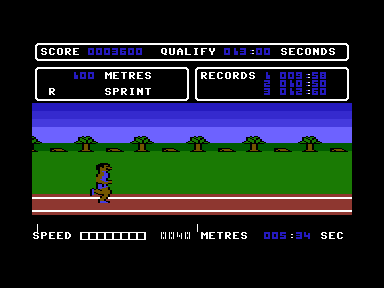
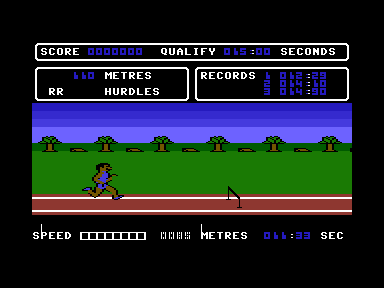
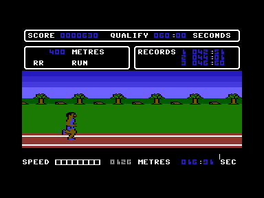
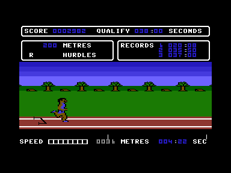
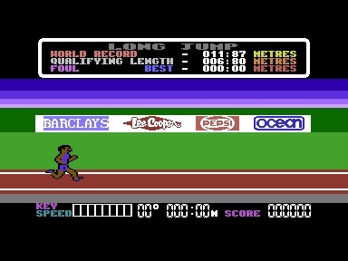
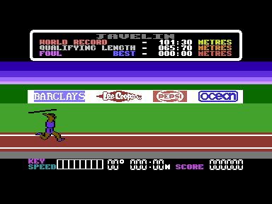

# Playing the Game

A player's guide to the C16 *Daley Thompson's Star Events*, written from the code. The tips follow from how the game actually works ([codebase analysis](../CODEBASE_ANALYSIS.md)); manual play on a real C16 has not yet been done, so treat the feel of each event as untested.

---

## Loading

Each part is on its own side of the tape. Type `LOAD"",1,1`, press PLAY, and when the loader has loaded type `SYS1536`. The loader then loads the game's two files from the same tape and starts it. Side 1 holds Day One, side 2 Day Two. In VICE, `python3 tools/run_tape.py 1` (or `2`) does all of this for you.

---

## Day One: The Running Events

Day One is four races in a fixed order: 100 m, 110 m hurdles, 400 m, 200 m hurdles. You start with three attempts (the R symbols under the distance), and each race you fail costs one.

**Controls.** Plug the joystick into control port 2 (in VICE, give port 2 a joystick); both days read only that port. Day One has no key option, but the keyboard works anyway: A is left, 4 is right, and E or SHIFT is fire. The game reads the joystick in a way that also reads the keyboard row holding these keys (checked in VICE). Q, Y and SPACE, Day Two's keys, do nothing here, and nor do the cursor keys.

**Start.** Each race starts by itself: the game shows ON YOUR MARKS, GET SET and GO, then the clock runs. After GAME OVER, press fire to play again.

**Running.** Move the joystick left and right in turn, or tap A and 4 in turn. Speed rises only when both directions have been seen since the last step, so holding one direction, or wiggling only one way, does nothing. Each full left-right pair adds 5 to the speed, or 2 once you are past about half the meter, and the speed bleeds away all the time, faster near the top. The SPEED meter at the bottom shows where you are.

**Hurdles.** In the hurdle events, press fire to jump. A jump can't start until the last one has finished, and each jump costs a little speed. Knocking a hurdle over only changes its picture: in this version it costs no time.

**Qualifying.** Each race has a qualifying time, shown at the top (QUALIFY). Beat it and you see QUALIFIED and score points; miss it and you see FAILED and lose an attempt. The race also ends if the clock reaches 70.

| Event           | Qualify | Records box (1st, 2nd, 3rd)  |
|:----------------|:--------|:-----------------------------|
| 100 m           | 13:00   | 9:58, 10:50, 12:60           |
| 110 m hurdles   | 15:00   | 12:29, 14:10, 14:90          |
| 400 m           | 60:00   | 42:51, 44:01, 46:60          |
| 200 m hurdles   | 38:00   | 20:08, 35:50, 37:00          |

The clock counts in its own units: one displayed second is 60 frames, which is 1.2 real seconds on a PAL C16 (exactly one second on an NTSC machine, measured in VICE; Day Two's distances, though, come out about 1.5 times longer on NTSC, so the game is meant for PAL), and the last digit only goes up to 5.

**Points.** A qualified race scores 6 × (255 − the sum of three of the time's digits as characters). Faster times give smaller digits and so more points. After the 200 m hurdles the four races start again, with your score kept, until the attempts run out.

---

## Day Two: The Field Events

Day Two is long jump, shot-put and javelin, with three attempts at each. Qualify with any of the three to go on to the next event; fail all three and you're back at the start screen.

**Controls.** On the start screen, press J for joystick or K for keys; the choice shows as JOY or KEY at the bottom left. With keys, Q and Y are left and right and SPACE is fire. These keys were checked in VICE. With the joystick, J, 0 and N should also work as left, right and fire, because the joystick reading takes the keyboard row that holds J and K (found in the code, not yet tried). The keyboard's speed drains a little more slowly than the joystick's.

**Run-up.** Alternate left and right as in Day One to build speed.

**Angle.** At the line, hold fire: the angle shown before `°` counts up from 20. Release fire to take off or throw. The angle stops at 83 if you hold on. Running on past the take-off point without releasing is a foul.

**Judging.** The box at the top shows the event's WORLD RECORD, its QUALIFYING LENGTH and your BEST. An attempt longer than the qualifying length qualifies; the three marks by FOUL show how each attempt went.

| Event      | World record | Qualifying |
|:-----------|:-------------|:-----------|
| Long jump  | 11.87 m      | 6.80 m     |
| Shot-put   | 17.60 m      | 13.90 m    |
| Javelin    | 101.30 m     | 65.70 m    |

**Points.** Each attempt's metres and tenths are added to your score, and the best score stays as the high score on the start screen.

**What makes a long throw or jump.** The distance is counted while the ground scrolls under the flight ([how far](../CODEBASE_ANALYSIS.md#how-far-the-distance-counter)). These figures come from take-offs forced in VICE, not from play by hand:

| Event     | Best angle | Distance at top speed | Too steep                         |
|:----------|:-----------|:----------------------|:----------------------------------|
| Long jump | 55–59°     | about 11.0 m          | 60° or more: about 4.6 m          |
| Shot-put  | 35–54°     | about 16.0 m          | Outside 35–54°: under 3 m         |
| Javelin   | under 35°  | about 122 m           | 67° or more: about 33 m           |

- **Speed** sets how fast the ground scrolls in flight, but the game reads only some bits of it, so more speed isn't always further: full speed and two steps short of it are equally good, but one step short throws or jumps about an eighth less.
- **The shot-put punishes a bad angle hard.** Outside 35–54° a fast run-up gives under 2 m and a slow one about 3 m.
- **The javelin goes past the world record** (101.30 m) if you release under 35° at full speed.
- **The long jumper can't land before the sand.** The jump lasts at least until he reaches the pit, so even a slow jump gives about 3.5 m.

- **Take off at the line.** Releasing early wastes ground before the counting starts. At full speed, taking off as the board appears instead of at the line cost 1.6 m in the long jump, 4.1 m in the shot-put and 13.8 m in the javelin.

A few hundredths of each distance are random.

