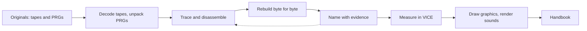
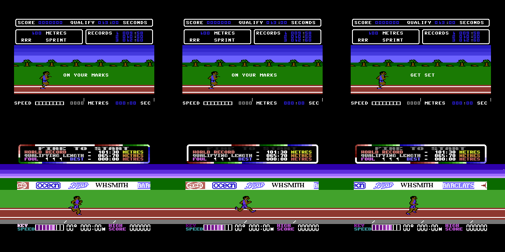
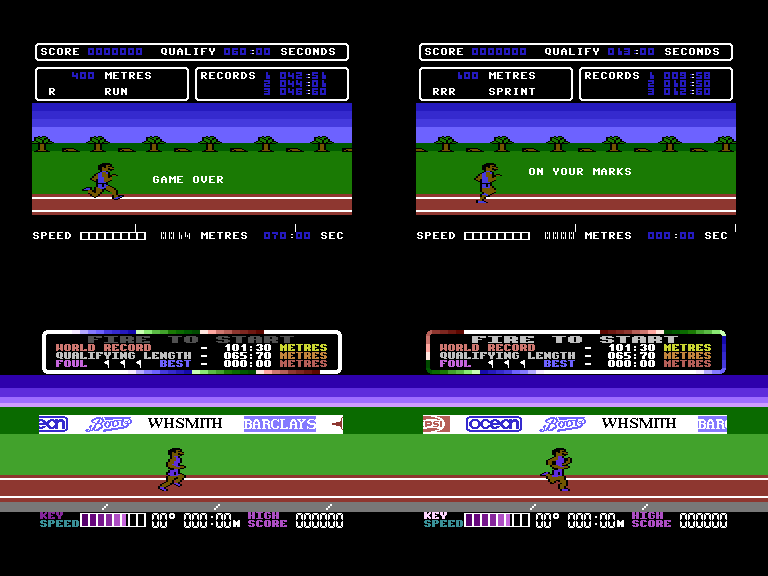

# Source and Validation

How the work was done, what proves the disassembly matches the original, and how the names are kept honest.

---

## How the Work Was Done

1. **Inventory.** The six originals were hashed into `original/SHA256SUMS` and described (`tools/prg_info.py`); nothing in `original/` is ever written.
2. **Tapes and unpacking.** The tapes were decoded block by block (`tools/c16_tap.py`), the crunched PRGs unpacked in VICE and, independently, in a 6502 emulator (`tools/unpack_sfx.py`), and the tape files matched against the unpacked images (`tools/tape_check.py`). Later, an Exomizer 2.0 build re-crunched the rebuilt game into the PRGs byte for byte (`tools/exo_check.py`).
3. **Disassembly.** `tools/disasm.py` traces code from evidenced entry points, writes a `da65` info file from `tools/symbols.py` and regenerates `src/`; `ca65` and `ld65` rebuild every block for comparison.
4. **Start-up check.** The original, the rebuilt crunched PRG and the rebuilt unpacked image were run side by side in VICE and from tape, to see the same screens (`tools/shots.py`, `tools/run_tape.py`).
5. **Naming.** Each name climbs the evidence ladder below: read from the code, seen at a breakpoint through VICE's remote monitor, or tested in a controlled run that patches VICE's RAM. Keys and joystick ports were pressed by hand in VICE while a breakpoint traced the result.
6. **Measurement.** Controlled runs measured speed, distances and timings: `tools/flight_probe.py` forced 189 Day Two take-offs on PAL and again on NTSC, and VICE's execution map checked that the trace misses no code.
7. **Graphics and sound.** `tools/render_graphics.py` draws the character sets, frames and objects from the images, running the game's own drawing routines in `tools/cpu6502.py` where it can; `tools/doc_shots.py` takes the screenshots. `tools/decode_tunes.py` reads the tunes as notes, and `tools/render_sounds.py` renders the clips from the game's own sound code.
8. **Documentation.** `tools/code_reference.py` writes the code reference from `symbols.py`, and `scripts/build_docs.mjs` builds this handbook from the Markdown.

How to run each script is in [build and run](BUILD_AND_RUN.md).

---

## No Source Survives

Anthony and Jason wrote the game on a C64 and loaded the result onto a C16; no source disk survives. The source in `src/` is therefore a disassembly, regenerated from the original binaries by `tools/disasm.py` with cc65's `da65`, under the names and comments in `tools/symbols.py`. `symbols.py` is the master: `src/*.s` is never edited by hand.

| Block            | From                                       | Range           |
|:-----------------|:-------------------------------------------|:----------------|
| `day_one_packed` | `daley_thompsons_star_events_day_one.prg`  | `$1001`–`$287B` |
| `day_two_packed` | `daley_thompsons_star_events_day_two.prg`  | `$1001`–`$2E0F` |
| `loader_side1`   | `dt_star_events_side1.tap`, file 1         | `$0600`–`$0642` |
| `loader_side2`   | `dt_star_events_side2.tap`, file 1         | `$0600`–`$0642` |
| `day_one`        | `day_one_unpacked_vice.prg`                | `$0FFE`–`$3FFF` |
| `day_two`        | `day_two_unpacked_vice.prg`                | `$07FE`–`$3FFF` |

The two packed blocks cover the decrunchers; their game data stays as bytes. The unpacked blocks are where the game is.

---

## The Gate: `make verify`

Every change has to pass `make verify`, which checks four things in turn:

1. The originals are unchanged (`shasum -c original/SHA256SUMS`).
2. Running each decruncher in a 6502 emulator (`tools/unpack_sfx.py`) gives exactly the unpacked images, which were dumped from VICE at the decruncher's final `JMP`. Two independent methods, one result.
3. Every game file on both tapes, placed where the loader puts it, equals the unpacked image (`tools/tape_check.py`).
4. Every block, reassembled from `src/` with `ca65` and `ld65`, is byte-identical to its original (`tools/disasm.py --check`).

The rebuilds start the same way as the originals (`tools/shots.py`); the three runs differ only by the frame VICE's autostart lands on, so the pictures are compared by eye, not by hash.

Loaded from the tape by its own loader (`tools/run_tape.py`), each side reaches the same game as the crunched PRG.

One more check runs by hand, because it needs an old Exomizer: `tools/exo_check.py` re-crunches the images rebuilt from `src/` with Exomizer 2.0 (2.0beta7–2.0.9) and gets both crunched PRGs byte for byte (see [the artifacts](ARTIFACTS.md)).

Original bugs and oddities stay in the build; they are recorded in [the quirks](quirks.md) instead of being fixed.

---

## Finding the Code

`da65` needs to know which bytes are code. `disasm.py` traces from each block's entry points, following branches, `JSR` and `JMP`, and stops at bytes declared as data. The entry points beyond the start address come from the code itself:

- **Raster splits.** The 13 split handlers in each part, read from the tables the IRQ handler patches its `JSR` from.
- **The event jump.** Day Two's three event handlers, from the table its self-modified `JMP` at `$2F11` reads.
- **Inline parameters.** The code after each `JSR PlayTunePair` call: the call is followed by two data words, and the `RTS` after them is code.

About 40% of Day One and 36% of Day Two trace as code; the rest is character sets, screens, tunes and tables.

**Coverage check.** VICE's execution map recorded which addresses ran during three runs of the original. Every executed instruction falls on an instruction start of the traced code, so the trace is missing nothing those runs reached. Details are in [the evidence](evidence.md).

---

## Names and Evidence

Names follow the evidence ladder from the restoration skill:

| Rung | Evidence                               | Allows                          |
|:-----|:---------------------------------------|:--------------------------------|
| 1    | Seen in the code                       | Descriptive names               |
| 2    | Seen running (screen, sample, trace)   | It runs, how often, from where  |
| 3    | Behaves as predicted in a controlled run | Role names: `Lives`, `RunSpeed` |
| 4    | Confirmed by Anthony                   | What a sprite, sound or mode is |

Each role-claiming name has a row in [the evidence](evidence.md) with what was seen and when. The source comment states the conclusion; the proof lives in the evidence. Every routine, variable and table has a name; only branch targets inside named routines stay `Lxxxx`.

The controlled runs change RAM in VICE only, never the build. For example, `SpeedDecay` is patched to `RTS` to hold `RunSpeed` at its maximum, and Day Two's FIRE TO START wait is removed so attempts run without input. `tools/doc_shots.py` takes the handbook's screenshots the same way, and `tools/flight_probe.py` forces Day Two take-offs by setting the speed, position and angle at two breakpoints.

---

## Not Yet Done

Manual play, listening on real hardware and running on a real C16 haven't been done. Everything here comes from the code and from VICE. Nothing in the code is left open; what still needs a person is in [the worklist](WORKLIST.md).
